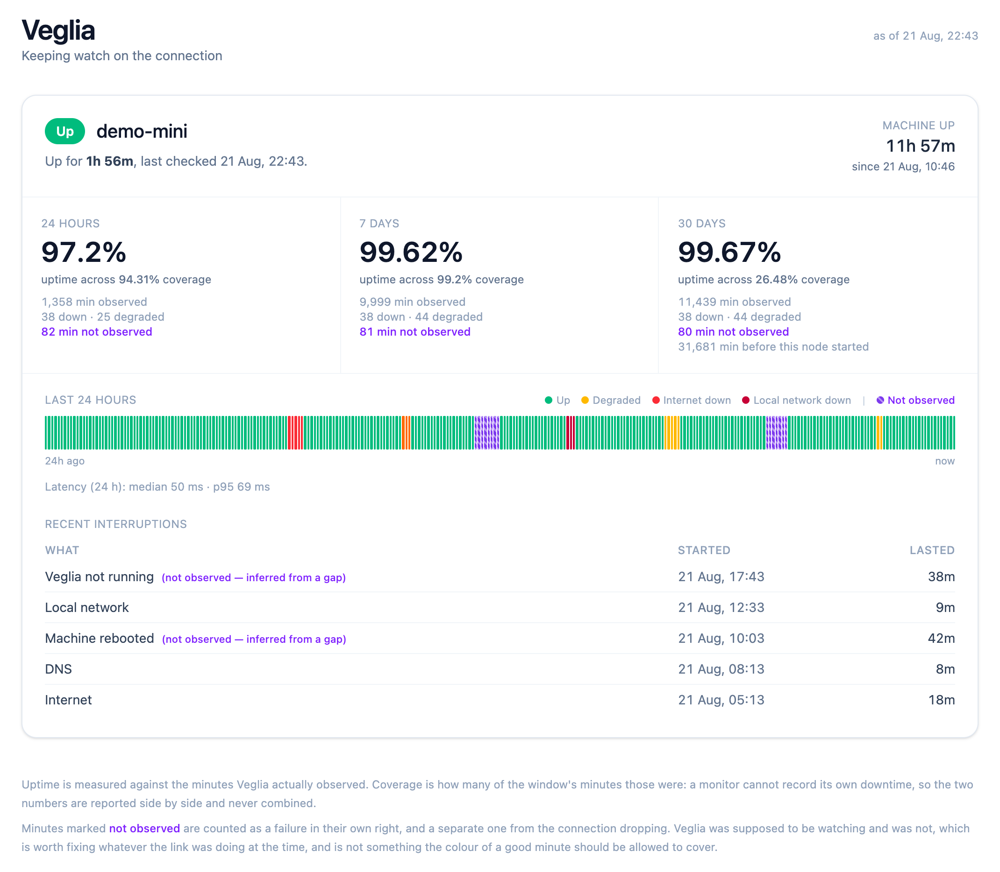

# Veglia

A small Rails application that sits on a machine at home, asks the
internet once a minute whether it is still there, and keeps an honest
record of the answer.

*Veglia* is Italian for a vigil: a watch kept through the night.



Every state it can report, shown at once. The data behind that screenshot
is generated by `bin/rails demo:seed`, because a healthy connection
produces a dashboard with one colour on it.

## What it actually measures

Two things that are related but not the same:

- **Is the connection up?** Probed every minute, in three tiers, so a
  red light says *which* thing broke rather than only that something
  did.
- **Is the machine up?** Taken from the kernel boot time and from the
  holes in Veglia's own record.

### The three tiers

| Tier | How | Tells you |
|---|---|---|
| Gateway | one ICMP packet to the default route | the router or Wi-Fi is the problem |
| DNS | a timed `Resolv::DNS` lookup | name resolution is the problem |
| HTTP | three independent 204 endpoints, quorum of two | the ISP is the problem |

All three run concurrently, so a check costs about as long as its
slowest probe. A quorum of two means one provider having a bad day is
that provider's outage rather than yours.

Classification checks **working internet first**. Plenty of routers
decline to answer ICMP, and a failed gateway ping alongside a satisfied
HTTP quorum means a quiet router, not a dead network.

## The one design rule

**A monitor running on the machine it monitors cannot observe its own
downtime.** When the machine reboots or Veglia crashes, no row is written,
and the naive reading of an empty stretch is "nothing was wrong". That
is how home dashboards end up reporting a flawless day for a day the
machine spent switched off.

So every check records the kernel boot time, and every check begins by
asking how long it has been since the last one. When there is a hole:

| Boot time across the hole | Reading |
|---|---|
| changed | the machine rebooted; the downtime is the machine's |
| unchanged | the machine was fine; Veglia was the thing missing |

And the dashboard always shows **two** numbers, never blended:

> 99.4% up **across 98.1% coverage**

Uptime is *of the minutes actually observed*. Coverage is *how many of
the window's minutes those were*. A figure without the second number is
not a measurement, it is a reassurance.

## Requirements

**macOS.** Veglia reads the kernel boot time from `sysctl
kern.boottime`, finds the default route with BSD `route -n get default`,
and installs itself as a `launchd` job. On Linux it will boot and the
HTTP and DNS tiers will work, but the gateway tier and reboot detection
will not; nothing has been done to make that case good.

**Ruby**, at the version in `.ruby-version` (`rbenv`, `asdf`, `mise` or
Homebrew are all fine). Nothing else. No Docker, no registry, no
database server, no external service, and no monitoring gem — every
probe is Ruby standard library.

## Trying it before installing it

To look at it without touching how the machine behaves:

```sh
bin/setup          # gems, database, assets
bin/dev            # http://localhost:3000
```

The dashboard will be empty, because the once-a-minute schedule only
runs in production. Write a few checks by hand to see it populated:

```sh
bin/rails runner '5.times { CheckRunner.call }'
```

Then install it properly when you want the record to be continuous.

To see it with every state it can report showing at once, rather than the
one colour a healthy connection produces:

```sh
bin/rails demo:seed   # eight days, every status and every outage kind
bin/dev
```

That is what the screenshot at the top of this file shows. The task
refuses to run in production, because the point of Veglia is that
its record is what actually happened. Everything in that screenshot is
generated: it is what the dashboard looks like when things go wrong, not a
day anyone had.

## Installing

```sh
./deploy/install.sh
```

That copies the app to `~/Applications/veglia`, puts its data in
`~/.local/share/veglia`, generates a per-machine secret, builds assets,
prepares the database and writes a launchd job. It then prints two
commands for you to run yourself, because both change how the machine
behaves:

1. installing and starting the `LaunchDaemon`
2. `pmset` settings so the machine neither sleeps nor stays down after a
   power cut

**The app is deliberately copied out of wherever this repo lives.** If
the repo sits on an external or encrypted volume, that volume mounts at
*login*, while a `LaunchDaemon` starts at *boot*. A job pointing into
`/Volumes` would fail on every reboot, which is precisely when the
monitor most needs to be running.

A `LaunchDaemon` rather than a `LaunchAgent` for the same reason: an
agent starts at login, and a headless machine that reboots at 4am may sit
for days with nobody logged in. The daemon starts at boot and drops to
your user, so nothing runs as root beyond launchd itself.

Then open `http://<hostname>.local:1440`.

Port 1440 is the number of minutes in a day, and so the number of
checks Veglia records in one. It was chosen mostly because it is free:
3000 collides with any stray `rails server`, and 4000 is Jekyll's
default.

## Running it on more than one Mac

Each node is **self-sufficient**: its own database, its own probes, its
own dashboard, no dependency on any peer being alive. Run
`deploy/install.sh` on each machine and each keeps its own record,
identified by hostname or by `VEGLIA_NODE`.

This is worth doing for a reason beyond redundancy. One vantage point
cannot distinguish "the internet is down" from "this machine's network
stack is wedged". Two can, and two disagreeing is itself the finding.

Aggregating those views into one dashboard is phase 2: a designated hub
and satellites that push to it while retaining their own history. Node
identity is already on every row, so that arrives without a migration.

## Configuration

| Variable | Default | Meaning |
|---|---|---|
| `VEGLIA_NODE` | hostname | this vantage point's name |
| `VEGLIA_STORAGE` | `storage` | where the SQLite databases live |
| `PORT` | `1440` | HTTP port |
| `VEGLIA_APP_DIR` | `~/Applications/veglia` | install target |
| `VEGLIA_DATA_DIR` | `~/.local/share/veglia` | data and logs |

Probe endpoints, the quorum, the degraded threshold, the 90-second gap
tolerance and the 90-day retention are all in `app/models/settings.rb`.

## Endpoints

- `/` the dashboard
- `/health` current state as JSON, including coverage
- `/up` Rails' own liveness check

## Operating

```sh
sudo launchctl kickstart -k system/dev.pardel.veglia   # restart
sudo launchctl bootout    system/dev.pardel.veglia     # stop
tail -f ~/.local/share/veglia/log/veglia.err.log       # logs
```

## Housekeeping

Raw per-minute checks are kept 90 days. Before they are pruned, each
completed day is rolled into a `DailyStat`, so the long record survives
the prune rather than being destroyed by it. Both run nightly at 3:10am.

## Exposure and security

Veglia has **no authentication**, and host authorisation is deliberately
left unset so any `Host` header is accepted — it is reached by several
names that are all legitimate (a `.local` name, a bare hostname, a LAN
IP that DHCP may change), and an over-tight list fails as a dashboard
that will not load with no clue on screen as to why.

That is a defensible trade for a read-only app on a home LAN, and only
that. **Do not port-forward it, tunnel it, or put it on a network you do
not control.** Anyone who can reach port 1440 can read your connection
history. If you want it reachable from outside, put it behind something
that does authentication properly and treat that as the change it is.

`SECRET_KEY_BASE` is generated per machine into a `0600` file under
`~/.local/share/veglia` rather than written into the plist, because
`/Library/LaunchDaemons` is world-readable. It is never committed, and
a second Mac needs no secret handed to it.

## Tests

```sh
bin/rails test
```

The suite concentrates on the parts that would fail quietly: gap
classification, the uptime-versus-coverage split, outage boundaries,
and the heatmap's worst-status-wins bucketing.

## Further reading

- [docs/ARCHITECTURE.md](docs/ARCHITECTURE.md) — every design decision
  and why it went the way it did
- [docs/OPERATIONS.md](docs/OPERATIONS.md) — runbook, troubleshooting,
  adding another Mac

## Licence

MIT. See [LICENSE](LICENSE).
